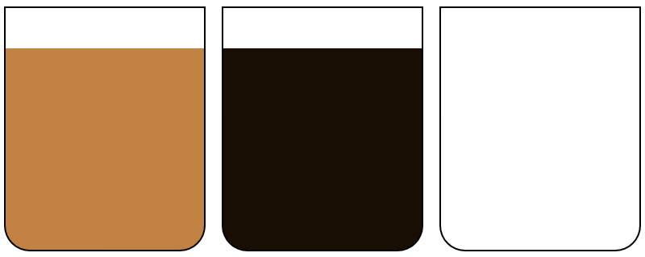

# Materi: DOM (Document Object Model)

Membuat program dengan memanfaatkan DOM untuk algoritma:
- Memindahkan air di dalam gelas.
- Gelas A berisikan teh.
- Gelas B berisikan kopi.
- Isi Gelas A dipindahkan ke Gelas B dan sebaliknya tanpa mencampur.

**Screenshot**

